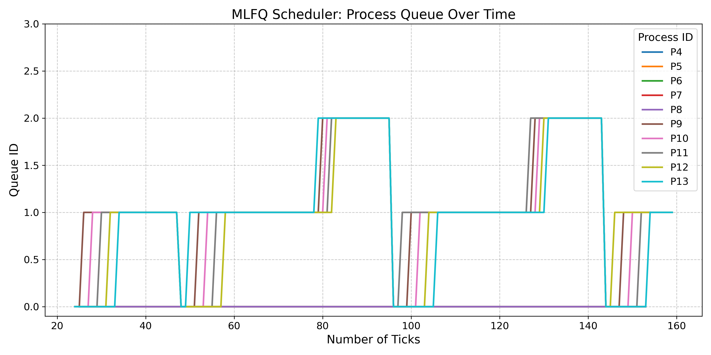
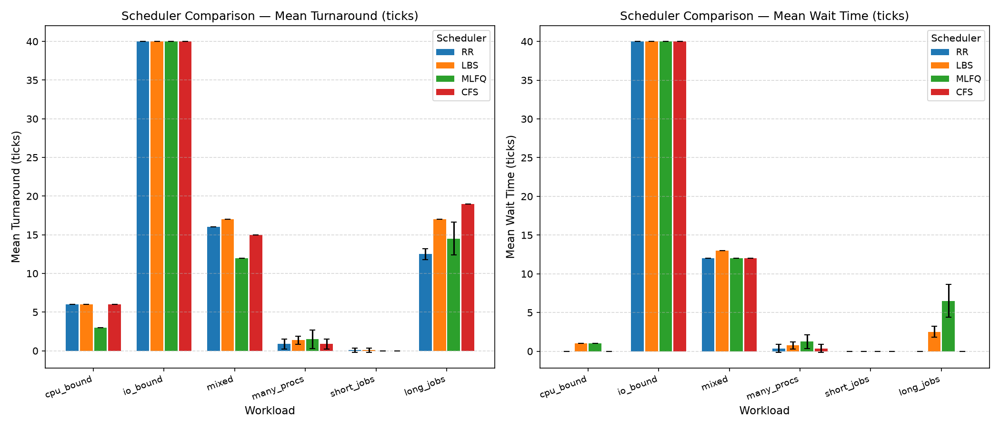

# Enhanced xv6 Operating System & Custom Unix Shell

[-blue.svg)](#technical-architecture)
[](https://github.com/sumansuman1212/Enhanced-XV6-RISCV/actions/workflows/build.yml)
[](#attribution--license)

A modular educational extension of the MIT xv6-RISC-V Unix operating system. This project incorporates multi-policy CPU scheduling, hardware-enforced Copy-on-Write (COW) virtual memory, process and memory observability subsystems, and a feature-rich Unix shell with recursive-descent parsing and background job management.

---

## Screenshots / Demo


*Figure 1: Multi-Level Feedback Queue (MLFQ) process queue progression over timer ticks, illustrating dynamic priority demotion and periodic priority boosting.*

<br>


*Figure 2: Empirical benchmark comparing Turnaround Time and Waiting Time across Round Robin, LBS, MLFQ, and CFS across 6 standardized workloads.*

---

## Table of Contents

1. [Project Overview](#project-overview)
2. [Screenshots / Demo](#screenshots--demo)
3. [Target Architecture & Environment](#target-architecture--environment)
4. [Feature Breakdown: Upstream vs. Enhancements](#feature-breakdown-upstream-vs-enhancements)
5. [Technical Architecture & Subsystems](#technical-architecture--subsystems)
   - [A. Pluggable CPU Schedulers](#a-pluggable-cpu-schedulers)
   - [B. Copy-on-Write (COW) Virtual Memory](#b-copy-on-write-cow-virtual-memory)
   - [C. Kernel Instrumentation & Observability](#c-kernel-instrumentation--observability)
   - [D. Custom Unix Shell (`nsh`)](#d-custom-unix-shell-nsh)
6. [System Call Interface](#system-call-interface)
7. [Build and Run Instructions](#build-and-run-instructions)
8. [Testing and Verification](#testing-and-verification)
9. [Architectural Limitations & Design Decisions](#architectural-limitations--design-decisions)
10. [Repository Structure](#repository-structure)
11. [Attribution & License](#attribution--license)

---

## Project Overview

The objective of this project is to deepen understanding of operating system internals by implementing real-world kernel features into xv6-RISC-V while maintaining safety, synchronization invariants, and educational clarity. 

Key engineering achievements include:
- **Pluggable Scheduling**: Support for Round Robin (`RR`), Lottery-Based (`LBS`), Multi-Level Feedback Queue (`MLFQ`), and Completely Fair (`CFS`-inspired) scheduling selectable at compile time.
- **Copy-on-Write Fork**: Reduced memory footprint and instantaneous process creation using RISC-V Sv39 page faults and physical reference counting.
- **Kernel Observability**: Lock-safe system calls (`getprocs`, `memstat`, `getSysCount`) and userland diagnostic tools (`procstat`, `memstat`, `syscount`).
- **Custom Unix Shell**: Robust command-line interface (`nsh`) featuring AST-based parsing, multi-stage pipelines, I/O and append redirection, and non-blocking background job tracking.

---

## Target Architecture & Environment

- **Base Operating System**: xv6-RISC-V (MIT 6.1810 teaching operating system, re-implementing Unix Version 6).
- **Target ISA**: 64-bit RISC-V (`rv64g` / `riscv64-unknown-elf` or `riscv64-linux-gnu`).
- **Memory Management Unit (MMU)**: RISC-V Sv39 paging scheme (3-level page tables, 4096-byte pages, 39-bit virtual addresses, 56-bit physical addresses).
- **Emulated Hardware Platform**: QEMU `virt` machine (`qemu-system-riscv64`) with VirtIO block devices, CLINT timer interrupts, and PLIC external interrupt controller.

---

## Feature Breakdown: Upstream vs. Enhancements

| Component | Standard MIT xv6-RISC-V | Enhanced xv6 Implementation |
| :--- | :--- | :--- |
| **CPU Scheduling** | Single Round Robin policy with 1-tick timer slices. | 4 compile-time policies: `RR`, `LBS`, `MLFQ` (4-priority with aging), and `CFS`-inspired (virtual runtime). |
| **Process Fork** | Eager memory copying (`uvmcopy` allocates all physical pages upfront). | Lazy Copy-on-Write (`uvmcopy` maps read-only with `PTE_COW`; faults allocate on demand). |
| **Process Observability** | Basic `ps` (if written), no runtime/wait metrics. | `getprocs` syscall providing CPU ticks, wait ticks, response latency, context switches, vruntime, page count, and fault counts. |
| **Memory Observability** | None (only static `kmem` free list). | `memstat` syscall providing active physical pages, free pages, peak memory usage, total allocations/frees, and COW faults. |
| **Signal/Alarm Mechanism** | None. | `sigalarm(ticks, handler)` and `sigreturn()` with trapframe backup/restore for periodic user callbacks. |
| **Process Waiting** | Blocking `wait(&status)` for any child. | `waitpid(pid, &status, options)` supporting specific PID matching and non-blocking polling (`options=1`). |
| **Shell** | Minimal `sh` (basic fork/exec, single pipe, single redirection). | Full `nsh` shell: AST recursive-descent parser, multi-stage pipes, append redirection (`>>`), history buffer, and job tracking (`jobs`, `fg`, `bg`). |

---

## Technical Architecture & Subsystems

```
                               +------------------------------------------+
                               |         User Space Applications          |
                               |  nsh (shell) | procstat | memstat | tests|
                               +------------------------------------------+
                                                    |
                                         ecall (RISC-V Traps)
                                                    v
+---------------------------------------------------------------------------------------------------+
|                                            xv6 Kernel                                             |
|                                                                                                   |
|  +--------------------+  +--------------------+  +--------------------+  +---------------------+  |
|  | Syscall Dispatcher |  |   Trap Handling    |  |  Virtual Memory    |  |   CPU Schedulers    |  |
|  | - waitpid, waitx   |  | - Store page fault |  | - Sv39 3-level PT  |  | - Round Robin (RR)  |  |
|  | - getprocs         |  |   (scause = 15)    |  | - PTE_COW (Bit 8)  |  | - Lottery (LBS)     |  |
|  | - memstat          |  | - Timer interrupt  |  | - Reference counts |  | - MLFQ (4 queues)   |  |
|  | - sigalarm/return  |  | - Exception return |  | - Safe memstat     |  | - CFS (vruntime)    |  |
|  +--------------------+  +--------------------+  +--------------------+  +---------------------+  |
|                                                    |                                              |
|  +-------------------------------------------------+-------------------------------------------+  |
|  |                            Process Table (struct proc proc[NPROC])                          |  |
|  |        State, Locks, Scheduling Metadata, Syscall Tracing Mask, Trapframe Backups           |  |
|  +---------------------------------------------------------------------------------------------+  |
+---------------------------------------------------------------------------------------------------+
                                                    |
                                        Hardware / QEMU Platform
                                                    v
                               +------------------------------------------+
                               |     QEMU 'virt' RISC-V Machine (rv64g)    |
                               |    CLINT Timers | PLIC | VirtIO Disk     |
                               +------------------------------------------+
```

### A. Pluggable CPU Schedulers

The kernel scheduler in `kernel/proc.c` can be configured at compile time via `make SCHEDULER=<TYPE>`:

1. **Round Robin (`RR`)**:
   Standard xv6 circular scan across the `proc[]` table. Each runnable process executes for a single timer tick before yielding.
2. **Lottery-Based Scheduler (`LBS`)**:
   - Each process is assigned a ticket count (default: 1; modified via `settickets(int)`).
   - The scheduler computes the sum of tickets among all `RUNNABLE` processes, generates a pseudo-random winning ticket, and context-switches to the corresponding process.
3. **Multi-Level Feedback Queue (`MLFQ`)**:
   - 4 priority queues (Priority 0 = highest, Priority 3 = lowest).
   - Time-slice slices: 1 tick (Q0), 3 ticks (Q1), 9 ticks (Q2), 27 ticks (Q3).
   - Dynamic demotion: A process consuming its entire time slice without blocking is demoted to a lower priority queue.
   - Priority boost (anti-starvation): Every 48 ticks, all processes are promoted back to Queue 0 to prevent starvation.
   - *Constraint*: MLFQ strictly enforces `CPUS=1` to preserve deterministic queue invariants.
4. **CFS-Inspired Scheduler (`CFS`)**:
   - Tracks a 64-bit virtual runtime (`vruntime`) for each process.
   - Virtual runtime updates dynamically on every tick:
     $$\Delta \text{vruntime} = \frac{\Delta \text{ticks} \times 1024 \times 1024}{\text{weight}}$$
   - Configurable scheduling weight via `setweight(pid, weight)` (default: 1024). Higher weight translates to slower `vruntime` growth, granting a larger share of CPU time.
   - Slices are bounded by a 4-tick quantum to balance throughput with interactive preemption latency.
   - *Implementation Note*: CFS scans the fixed `proc[NPROC]` array in $O(N)$ time per context switch rather than a Linux red-black tree, maintaining simplicity while replicating fair-share queuing dynamics.

### B. Copy-on-Write (COW) Virtual Memory

Standard xv6 allocates duplicate physical frames for child processes during `fork()`, resulting in substantial memory consumption and high allocation latency. The enhanced COW implementation defers physical allocation:

1. **PTE Flag Allocation**:
   Sv39 page table entries reserve bits 8 and 9 (`RSW`) for operating system software use. Bit 8 is assigned as `PTE_COW` (`1L << 8`), preserving Bit 5 (`PTE_G`, Global) for architectural compliance.
2. **Fork Mapping (`uvmcopy`)**:
   Instead of allocating new frames, `uvmcopy` maps the parent's physical pages into the child's address space with the write bit cleared (`*pte &= ~PTE_W`) and COW bit set (`*pte |= PTE_COW`).
3. **Reference Counting (`cow_ref`)**:
   A dedicated reference table `cow_ref.ref[PA2REF(pa)]` tracks physical page shares, protected by `cow_ref.lock`. `uvmcopy` calls `cow_incref(pa)` for each shared page.
4. **Page Fault Handling (`cow_handler`)**:
   When a process attempts to write to a COW page, the RISC-V core triggers a store page fault (`scause == 15`). In `kernel/trap.c`, the kernel catches the fault, verifies user permissions and `PTE_COW`, allocates a fresh physical page via `kalloc()`, copies the 4096 bytes from the shared page, decrements the shared page's reference count, and remaps the faulting virtual address with `PTE_W` enabled and `PTE_COW` cleared.

### C. Kernel Instrumentation & Observability

- **`memstat` Subsystem**:
  Kernel allocator metrics tracked under `mem_stats_lock`:
  - `active_pages`: Currently allocated physical memory pages.
  - `free_pages`: Pages available on `kmem.freelist`.
  - `total_allocs` / `total_frees`: Cumulative allocator operations.
  - `peak_pages`: High-water mark of allocated memory.
  - `total_faults` / `cow_faults`: Page-fault counts attributed globally and per-process.
- **`procstat` Subsystem**:
  Process table inspection tool displaying point-in-time metrics:
  - Process ID, Parent PID, state (`UNUSED`, `USED`, `SLEEP`, `RUNNABLE`, `RUNNING`, `ZOMBIE`).
  - `CPU_TICKS`: Accumulated runtime ticks.
  - `WAIT_TICKS`: Time spent waiting in the runnable queue.
  - `RESP_TICKS`: Latency between creation and first execution.
  - `CTX_SWITCHES`: Cumulative scheduling dispatches.
  - `VRUNTIME`: Virtual runtime (under CFS).
  - `VM_PAGES`: Allocated virtual memory pages.
  - `FAULTS` & `COW_FAULTS`: Page-fault counts per process.

### D. Custom Unix Shell (`nsh`)

Located in `user/nsh.c`, `nsh` replaces standard `sh` as the default interactive shell in `user/init.c`:
- **Recursive-Descent Parser**: Builds an Abstract Syntax Tree (AST) supporting execution nodes, pipelines, redirection nodes, and background job nodes.
- **Pipelining**: Supports multi-stage pipelines (`cmd1 | cmd2 | cmd3`) with strict descriptor hygiene (both read and write ends of each pipe are closed in non-participating processes to prevent hanging EOF reads).
- **Redirection**:
  - Input redirection: `< file`
  - Output truncation: `> file`
  - Output append: `>> file` (safely advances file offset to EOF before command execution).
- **Background Job Management**:
  - Appending `&` forks the command tree into the background and records it in a job table (`struct job jobtab[MAXJOBS]`).
  - Shell reaps completed background children asynchronously on every command cycle via non-blocking `waitpid(-1, &status, 1)`.
  - Built-in `jobs` lists active and finished jobs; `fg <jid>` brings a background job to the foreground.
- **Interactive Built-ins**: `cd`, `pwd`, `history`, `jobs`, `fg`, `bg`, and `exit` execute in-process within the shell so state transitions (such as current working directory) persist.

---

## System Call Interface

The operating system extends xv6 with 9 production system calls:

| System Call | Signature | Syscall # | Description |
| :--- | :--- | :---: | :--- |
| `waitx` | `int waitx(int *wtime, int *rtime)` | 22 | Waits for a child process to exit, reporting total wait and CPU execution ticks. |
| `getSysCount`| `int getSysCount(int mask)` | 23 | Queries the number of times a specific system call was invoked by the process or its child. |
| `sigalarm` | `int sigalarm(int ticks, void (*handler)())` | 24 | Schedules a periodic user-space alarm handler executed every `ticks` CPU cycles. |
| `sigreturn` | `int sigreturn(void)` | 25 | Restores caller trapframe state after completing a `sigalarm` callback. |
| `settickets` | `int settickets(int number)` | 26 | Assigns lottery tickets to the calling process for `LBS` scheduling. |
| `setweight` | `int setweight(int pid, int weight)` | 27 | Sets the scheduling weight of a process under the `CFS` scheduler. |
| `memstat` | `int memstat(struct memstats *st)` | 28 | Copies a consistent snapshot of system memory and page-fault statistics. |
| `waitpid` | `int waitpid(int pid, int *status, int options)` | 29 | Waits for a specific child PID. If `options == 1`, performs a non-blocking check. |
| `getprocs` | `int getprocs(struct procinfo *ps, int max)` | 30 | Populates an array of `procinfo` structs with point-in-time process metrics. |

---

## Build and Run Instructions

### Prerequisites

Install a RISC-V cross-compiler and QEMU emulator:

```sh
# Debian / Ubuntu / WSL2:
sudo apt-get update
sudo apt-get install -y gcc-riscv64-linux-gnu build-essential qemu-system-misc
```

### Compilation and Boot

Build and launch xv6 in QEMU:

```sh
# 1. Standard Round Robin (Multicore: 3 CPUs)
make clean
make qemu SCHEDULER=RR CPUS=3

# 2. Completely Fair Scheduler (Multicore: 3 CPUs)
make clean
make qemu SCHEDULER=CFS CPUS=3

# 3. Lottery-Based Scheduler (Multicore: 3 CPUs)
make clean
make qemu SCHEDULER=LBS CPUS=3

# 4. Multi-Level Feedback Queue (Single Core enforced)
make clean
make qemu SCHEDULER=MLFQ CPUS=1
```

To exit QEMU at any time: Press `Ctrl-A` then `X`.

---

## Testing and Verification

All test suites have been verified with a **100% pass rate** in the QEMU environment:

| Test Program | Focus Area | Result | Description |
| :--- | :--- | :---: | :--- |
| `nsh_test` | Custom Shell (`nsh`) | **15 / 15 Passed** | Automated verification of builtins (`cd`, `pwd`), input/output/append redirection (`<`, `>`, `>>`), multi-stage pipelines (`\|`), background execution (`&`), and syntax error isolation. |
| `memstat_test` | Memory & Allocator | **10 / 10 Passed** | Validates physical page allocation, deallocation, active/peak page counters, store page fault handling, and COW page fault isolation. |
| `cfs_test` | CFS Scheduler | **10 / 10 Passed** | Verifies process weight adjustments, `vruntime` progression, CPU fair-share proportions, quantum bounds, and wait latency tracking. |
| `alarmtest` | Signal Mechanism | **4 / 4 Passed** | Verifies periodic `sigalarm` triggering, user-space handler invocation, trapframe restoration via `sigreturn`, and register preservation across interrupts. |
| `lazytest` | COW Virtual Memory | **Passed** | Stress tests COW page allocations and writes across multiple concurrent processes. |
| `schedulertest`| Schedulers | **Passed** | Benchmarks turnaround, response, and CPU execution metrics across multiple concurrent child processes. |
| `procstat` | Observability | **Passed** | Diagnostic command displaying process table metrics, context switches, mapped pages, and fault counters. |
| `syscount` | Syscall Interception | **Passed** | Intercepts, masks, and logs execution counts for target system calls. |

---

## Architectural Limitations & Design Decisions

To preserve educational clarity and kernel safety, the following deliberate design constraints are maintained:

1. **Page Swapping / Disk Eviction Omission**:
   Real page swapping to disk is **intentionally not implemented**. In xv6, the VirtIO block device and buffer cache subsystems can sleep (`sleep()`), whereas the physical memory allocator (`kmem`), process state transitions, and page table walks hold non-reentrant spinlocks. Performing disk I/O synchronously during page allocation or within the trap path would cause lock-order inversions and kernel panics. Memory exhaustion returns standard allocation failure (`0`).
2. **MLFQ Single-Core Constraint**:
   The MLFQ scheduler requires `CPUS=1`. Multiprocessor MLFQ implementations without per-CPU queues or complex cross-core migration locks suffer from cache thrashing and lock contention on shared priority queues.
3. **Non-POSIX Shell Job Control**:
   `nsh` provides background process tracking via `waitpid()`, but is not a fully POSIX-compliant job controller because xv6 lacks process groups (`setpgrp`), terminal session arbitration (`tcsetpgrp`), and process stopping/continuation signals (`SIGSTOP`/`SIGCONT`). The `bg` built-in explicitly documents this limitation rather than fabricating behavior.
4. **User Stack Boundary**:
   xv6 user processes are allocated a single 4096-byte stack page bounded by an unmapped guard page. Large buffers in userland programs (e.g., process table arrays in `procstat`) are placed in static storage (`BSS`) to avoid silent stack overflow exceptions.

---

## Repository Structure

```
.
├── .github/               # GitHub Actions CI workflows
│   └── workflows/
│       └── build.yml      # Multi-scheduler build verification
├── Makefile               # Build configuration (SCHEDULER=, CPUS=, toolchain setup)
├── README.md              # Comprehensive project and portfolio documentation
├── .gitignore             # Ignore rules for object files, kernels, and disk images
├── LICENSE                # MIT License with original and extension copyrights
├── benchmarks/            # Scheduler Benchmarking & Statistical Framework
│   ├── METHODOLOGY.md     # Experimental methodology and measurement protocols
│   ├── run_all.sh         # Multi-policy benchmark execution runner
│   ├── analyze.py         # Metrics processing and performance visualization
│   └── results/           # Benchmark result logs and summaries
├── docs/                  # Documentation & Empirical Evaluation Artifacts
│   └── mlfq/              # MLFQ timeline traces, graphs, and plotting script
│       ├── data.txt       # Primary trace log (pid, ticks, queue)
│       ├── data2.txt      # Secondary workload trace log
│       ├── mlfq_timeline_1.png # Visual timeline of MLFQ priority queues
│       ├── mlfq_timeline_2.png # Secondary timeline visualization
│       ├── plot_mlfq.py   # Trace plotting utility
│       └── README.md      # MLFQ benchmark overview and instructions
├── kernel/                # xv6 Kernel Core
│   ├── defs.h             # Kernel function prototypes
│   ├── kalloc.c           # Physical memory allocator, COW refcounts, memstat
│   ├── memlayout.h        # Physical memory layout & PA2REF macro
│   ├── memstats.h         # Memory statistics structures
│   ├── param.h            # System parameters (NPROC=64, NCPU=8, etc.)
│   ├── proc.c             # Process table, lifecycle, RR, LBS, MLFQ, CFS schedulers
│   ├── proc.h             # struct proc definition and scheduler metadata
│   ├── procinfo.h         # struct procinfo definition for observability
│   ├── riscv.h            # RISC-V CSR helpers & PTE flags (PTE_COW = Bit 8)
│   ├── spinlock.c/h       # Spinlock mutual exclusion
│   ├── syscall.c/h        # Syscall jump table and argument decoders
│   ├── sysproc.c          # Syscall implementations (waitx, getprocs, memstat, etc.)
│   ├── trap.c             # Interrupt dispatch, timer preemption, COW store fault trap
│   ├── vm.c               # Sv39 page table management and uvmcopy (COW fork)
│   └── ...                # Drivers, console, and filesystem implementation
├── user/                  # User Space Utilities & Test Suites
│   ├── nsh.c              # Enhanced Unix shell (AST parser, pipes, jobs)
│   ├── nsh_test.c         # Automated test suite for nsh (15 tests)
│   ├── procstat.c         # Process introspection tool
│   ├── memstat.c          # Memory statistics tool
│   ├── memstat_test.c     # Automated memory & COW test suite (10 tests)
│   ├── cfs_test.c         # Automated CFS scheduler test suite (10 tests)
│   ├── alarmtest.c        # Automated sigalarm/sigreturn test suite
│   ├── lazytest.c         # Automated COW fork stress test suite
│   ├── schedulertest.c    # Multi-process scheduler benchmark tool
│   ├── syscount.c         # Syscall invocation tracer
│   └── ...                # Standard xv6 utilities (ls, cat, echo, grep, rm)
└── mkfs/                  # Filesystem image builder
    └── mkfs.c             # Generates fs.img
```

---

## Attribution & License

This project is built on MIT's [xv6-RISC-V](https://github.com/mit-pdos/xv6-riscv) operating system (copyright Frans Kaashoek, Robert Morris, and Russ Cox) and retains the original MIT license.

Enhanced scheduling algorithms (MLFQ, CFS, LBS), Copy-on-Write virtual memory, kernel observability interfaces (`memstat`, `getprocs`, `procstat`), signal infrastructure, and the custom `nsh` Unix shell are modifications developed by SUMAN SAURABH under the same MIT license terms (see [LICENSE](LICENSE)).
